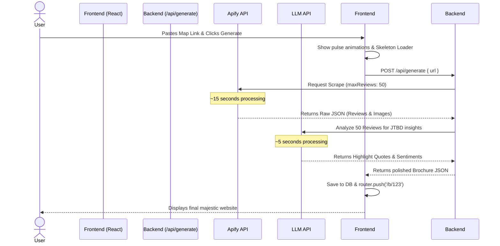

# UI & Data Flow for LocalBrochure MVP

This document outlines the step-by-step experience a user will have when interacting with the SaaS, and how the frontend links to the backend API.

## Step 1: The Landing Page (Input)
1. **User lands on `localhost:3000` (Home Page)**.
2. They see the premium hero section and input box.
3. They paste their Google Maps URL (e.g., *Paris Panini*) into the text box.
4. They click the **"Generate →"** button.

## Step 2: The Skeleton Loader (Waiting State)
1. The moment they click Generate, the Next.js frontend prevents normal page refresh and intercepts the URL via a React `onSubmit` function.
2. The UI instantly swaps the input form for a highly premium **"Skeleton Loader"** or progress page. 
   - *Visuals:* Pulse animations, text stating "Analyzing 50+ reviews...", "Downloading brand photos...", "Running sentiment analysis...".
3. Under the hood, the frontend silently makes a request to our newly built backend route: `fetch('/api/generate', { method: 'POST', body: { url } })`.

## Step 3: Backend Processing (The Engine)
While the user watches the beautiful skeleton loader, the backend (`app/api/generate/route.ts`) goes to work synchronously:
1. **Apify Scraper**: Sends the URL to Apify. Waits ~10-15 seconds. Returns 50 reviews, business info, coordinates, and Google image URLs.
2. **LLM Transformation**: (Pending Integration) Sends the 50 reviews to an AI like Gemini. The AI reads them to discover the true *Jobs-to-be-Done* (e.g., "Customers hire this restaurant for cozy date nights") and extracts the absolute best testimonial quotes.
3. **Packaging**: The backend packages the raw Apify data and the LLM insights into a clean, unified JSON bundle.

## Step 4: Page Transition (The Reveal)
1. The browser's `fetch` request resolves, bringing back the perfect JSON bundle to the React frontend.
2. The frontend stops the loading animation and dynamically builds the page (and saves the data to a database for future sharing).
3. The frontend immediately transitions the user to their unique brochure using the Next.js Router: `router.push('/b/unique-id')`.

## Step 5: The Brochure Page (Output)
1. The user lands on the majestic dynamic route `/b/unique-id`.
2. The page renders the glassmorphic cards, populates the hero section with the best Google Maps image, and highlights the specific LLM-curated quotes and sentiment analysis.
3. The user copies the URL from their browser's address bar to use in their marketing!

## Visual Sequence Diagram

